## Hi there

I'm Byeongmin, a backend engineer working on a B2B SaaS for maritime logistics.

- Into data pipelines, geospatial data, and AI-assisted coding
- Building tools for databases, IDEs, and AI agents on the side

## Projects

| Project | Stack | Description |
| --- | --- | --- |
| [tabularis-extended](https://github.com/hei5enbug/tabularis-extended) | TypeScript, Rust | Personal fork of Tabularis that gives its MCP server the database features coding agents expect, with SQL Server, PostGIS, and Cosmos DB extensions |
| [agentellij](https://github.com/hei5enbug/agentellij) | Kotlin | IntelliJ IDEA plugin that connects agentic coding tools to your IDE |
| [hei5enbug-agent-setup](https://github.com/hei5enbug/hei5enbug-agent-setup) | Python | Personal harness for Claude Code and Codex: skills, session instructions, and guard hooks |
| [kube-service-tunnel](https://github.com/hei5enbug/kube-service-tunnel) | Go | Interactive TUI for Kubernetes service port forwarding and DNS management |

## Stats

  <picture>
    <source media="(prefers-color-scheme: dark)" srcset="https://raw.githubusercontent.com/hei5enbug/hei5enbug/main/stats/stats-dark.svg">
    
  </picture>
  <picture>
    <source media="(prefers-color-scheme: dark)" srcset="https://raw.githubusercontent.com/hei5enbug/hei5enbug/main/stats/top-langs-dark.svg">
    
  </picture>

